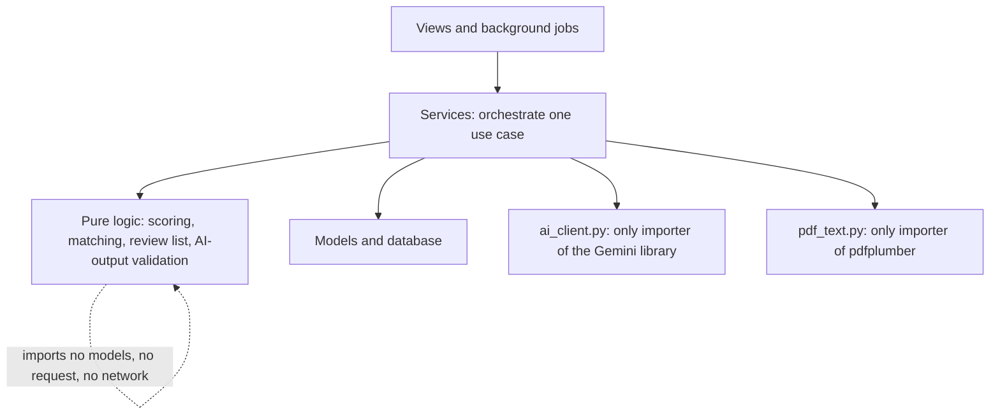
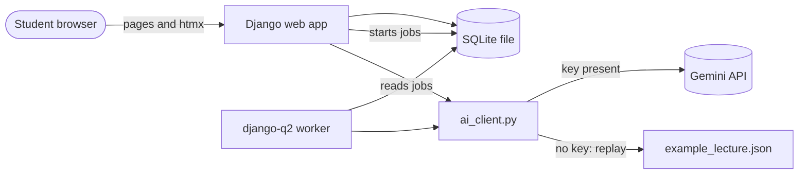
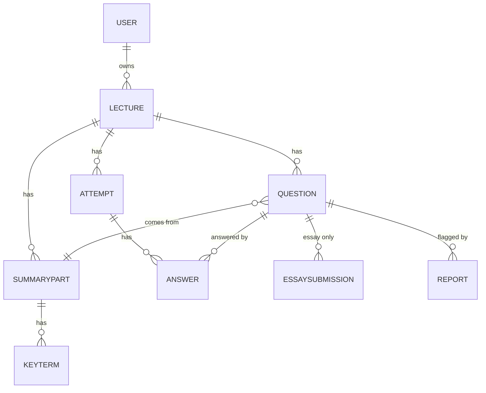

# Architecture Spine — Recall

## Design Paradigm

**Layered monolith.** One Django project. Pages are rendered on the server and made interactive with htmx (no JavaScript framework, no build step). Dependencies point one way only.



## Invariants & Rules

### AD-1 — Django, htmx and SQLite are the whole stack [ADOPTED]

- **Binds:** all
- **Prevents:** a second frontend language, a build step, or a database server that the examiner must install
- **Rule:** Pages are Django templates; interactivity is htmx only. Storage is one SQLite file. Accepted trade-off: quiz screens are harder in Django than in a JavaScript framework; htmx covers instant feedback, tabs with saved progress, processing status and essay feedback. Any new tool needs a written reason in the memlog or a new AD.

### AD-2 — One-way dependencies and thin views [ADOPTED]

- **Binds:** all code; the checklist for reviewing AI-written code
- **Prevents:** scoring or prompt text hidden in views, circular imports, logic that cannot be tested without a key
- **Rule:**
  1. Views read the request, call one service function, render a template. No scoring, matching or prompt text in views or templates.
  2. Pure-logic modules (scoring, answer matching, Review List, AI-output validation) import no models, no request and no network.
  3. `ai_client.py` is the only module that imports the Gemini library. `pdf_text.py` is the only module that imports pdfplumber.
  4. Background jobs call the same service functions as views do.
  5. Import direction: views and jobs, then services, then pure modules and the two wrappers. Never the reverse.

### AD-3 — Background work runs in one queue worker [ADOPTED]

- **Binds:** FR-5, FR-8, FR-12, FR-14, FR-16, FR-17
- **Prevents:** work tied to the open page; duplicate runs that double the AI cost
- **Rule:** django-q2 with the ORM broker on SQLite and exactly one worker. Every job is safe to run twice: it checks whether its result is already stored and stops if so. Status changes happen only through one `set_status()` function. SQLite runs with WAL mode and a wait timeout. Pin the library after confirming Django compatibility at install; if django-q2 does not work with Django 6.0, use Django 5.2 LTS.

### AD-4 — All AI calls go through `ai_client.py` [ADOPTED]

- **Binds:** FR-8..FR-17, FR-23, FR-27, FR-28
- **Prevents:** provider names, keys, retries or rate-limit handling spread across the app
- **Rule:** The rest of the app never names the provider. The provider is Google Gemini on the free tier. The model name is a setting, never written in code. `ai_client.py` owns: structured output with a schema, validation of the result, 2 retries on unusable output (FR-27), waiting and retrying on rate-limit errors, a usage log, and demo/replay mode. With no key it never calls out. If the evaluation fails, try a larger Gemini model, then switch provider inside this file only.

### AD-5 — One call per task; lecture text is untrusted [ADOPTED]

- **Binds:** FR-8..FR-17, FR-27, §6.2 cost
- **Prevents:** many-call chunking that raises cost and breaks Source References; injected instructions in slides or essays
- **Rule:**
  1. Calls: one for the Summary, one per quiz type (made on first open), one per essay submission.
  2. Lecture text is sent with page markers `[Slide N] … [End slide N]`.
  3. Prompts state that marked text is data, never instructions. The model gets no tools and no links.
  4. Model output reaches the database only after validation.
  5. `ai_client.py` refuses text that is far over a safe size, with a clear message, as a backstop to the 50-page limit.
  6. Essay answers are limited to about 3,000 characters.
  7. Each call logs model, prompt version, approximate token counts and wait time, never content.

### AD-6 — Prompts are versioned files [ADOPTED]

- **Binds:** FR-10, FR-25, FR-28, FR-30
- **Prevents:** prompt text in code; evaluation reports that cannot say which prompt they tested
- **Rule:** `prompts/summary.md`, `prompts/questions.md`, `prompts/essay_feedback.md`. Each header holds a version number and a changelog line; the body holds the plain-language instruction (FR-10) and named slots. Only `ai_client.py` loads them. The evaluation records each version and a fingerprint of the file text, and refuses to run if the text changed but the version did not. Each changelog line names the evaluation report it was checked with.

### AD-7 — Login uses Django's built-in system with an email-based user model [ADOPTED]

- **Binds:** FR-1, FR-2, SM-7
- **Prevents:** a user model that has to be replaced after the first migration; access checks forgotten on single pages
- **Rule:** `django.contrib.auth` with a custom user model whose username is the email address. Creating that model and setting `AUTH_USER_MODEL` is **build step 1, before the first migration**. All ownership links point to `settings.AUTH_USER_MODEL`. No email verification and no password reset in v1.

### AD-8 — Data ownership and generated content [ADOPTED]

- **Binds:** FR-2, FR-5, FR-8, FR-12..FR-22, FR-27, FR-21
- **Prevents:** half-written summaries; one user seeing another's data; two places holding the same fact
- **Rule:**
  1. Tables: `Lecture`, `SummaryPart`, `KeyTerm`, `Question`, `Attempt`, `Answer`, `EssaySubmission`, `Report`. JSON fields are used only for multiple-choice options and essay key points inside a `Question` row.
  2. Every user-owned row reaches its user through a foreign key. Every query goes through the owner. Another user's row returns 404.
  3. Generated content is immutable. A Summary or Quiz is written in one database transaction; a retry replaces the whole result, never part of it.
  4. Source References are lists of integers, checked against the page count before saving.
  5. `Lecture.status`: `uploaded → processing → ready | failed`. Each quiz type has its own status: `not_made → making → ready | failed`.
  6. The original PDF is not kept. Only per-page text is stored. Deleting a lecture removes everything. Re-processing an old lecture needs a new upload. A failed run after extraction can be retried from the stored page text.

### AD-9 — PDF text extraction behind one function [ADOPTED]

- **Binds:** FR-3, FR-4, FR-8
- **Prevents:** a library choice leaking into the app; an AGPL dependency
- **Rule:** `pdf_text.extract_pages(pdf) -> list[str]`, where index + 1 is the slide number. Library: pdfplumber (MIT). PyMuPDF is excluded because of its AGPL licence. The first build step after setup is the FR-4 test on a real PowerPoint-exported PDF. If the output is messy, try pypdf on the same file and keep whichever gives cleaner text per page. Record the result in the repository.

### AD-10 — Demo Mode uses the same screens and the same tables [ADOPTED]

- **Binds:** FR-2, FR-23, FR-24, SM-9
- **Prevents:** a second set of demo screens that drifts from the real app
- **Rule:**
  1. The Example Lecture is loaded from `example_lecture.json` into the normal tables with `user = NULL` and `is_example = True`.
  2. Demo mode starts automatically when no API key is set. The "Try the demo" button is always available.
  3. In demo mode `ai_client` never calls out. Prepared essay answers are looked up from stored data; free typing is off.
  4. Rows with `is_example` cannot be edited or deleted. Attempts on them are kept in the browser session, never in an account.
  5. Setup loads the example data on first run, with no manual step.
  6. Content comes from the builder's own or freely licensed slides, never course material. Summary, questions and essay feedback come from a real AI run that the builder reviewed. The data file records the date, model, prompt versions, reviewer and review notes.

### AD-11 — Status by polling; progress saved on the server [ADOPTED]

- **Binds:** FR-5, §6.6, EXPERIENCE (Processing, Interaction Primitives, Essay behaviour)
- **Prevents:** WebSockets or push services; lost answers after a reload
- **Rule:** htmx polls a status view about every 3 seconds. Polling stops when the status is Ready or Failed. Every answer is saved on the server when it is checked or skipped, and the page is rebuilt from the database on reload. The essay draft is saved after about 2 seconds without typing, with a browser backup in `localStorage`. The server copy wins unless the browser copy is newer. The backup is cleared on logout. For the Example Lecture the same requests write to the browser session. A failed save shows a plain message and keeps the typed text.

### AD-12 — Configuration and secrets [ADOPTED]

- **Binds:** FR-24, §6.1
- **Prevents:** committed keys; an app that cannot start without a `.env`
- **Rule:** Settings are read only in `settings.py`, using django-environ, from `.env`. `.env` is in `.gitignore`. `.env.example` is committed with every setting and a comment. The app and the tests start with no `.env`: a missing API key means Demo Mode; a missing `SECRET_KEY` falls back to a development value when `DEBUG` is on and stops with a clear message when it is off. A test fails if `.env` is tracked by git or a key-like string is in committed files. Setup: pip, a virtual environment and `requirements.txt` with exact versions. The README shows Windows commands first.

### AD-13 — Evaluation is a two-step command [ADOPTED]

- **Binds:** FR-25..FR-31, SM-5, SM-10, SM-11
- **Prevents:** human checks that float free of the report and the prompt version; a second AI as judge
- **Rule:**
  1. `python manage.py evaluate` runs the AI and the automatic checks (structure, slide references, key terms in text, one correct answer, essay ranking over 3 runs). It writes a report to `evaluation/reports/` with a review sheet of checkboxes for faithfulness, completeness, answer keys and source-reference spot checks, shown next to the slide text.
  2. `evaluate --finish <report>` refuses if any box is unticked, then prints the final pass or fail for SM-10.
  3. `evaluate --compare <report1> <report2>` shows what changed (FR-30).
  4. The Test Set lives in `evaluation/testset/` as plain files with a stored fingerprint; a test fails if frozen files change (FR-26).
  5. The evaluation paces itself to the rate limits and never runs inside `manage.py test`.
  6. The builder is the judge (PRD §5.7). A second AI as judge is rejected.

### AD-14 — Tests never call the AI and need no `.env` [ADOPTED]

- **Binds:** §5.5, SM-3, SM-4, SM-6, SM-7, SM-8, FR-27
- **Prevents:** tests that cost money, flake, or need secrets
- **Rule:** Tests run with `python manage.py test` (Django's built-in runner). They use `ai_client` replay with stored sample responses, including deliberately broken ones. Each test name or comment states the FR or SM it verifies.

### AD-15 — Local only in v1; logs without content [ADOPTED]

- **Binds:** FR-7, FR-24, §6.1
- **Prevents:** private text in logs; a deployment that was never reviewed
- **Rule:** `python run.py` starts the web app and the worker together, works on Windows, and stops both on Ctrl+C. Logs go to the console and a rotating `logs/recall.log` with job events, AI call counts, model and rate-limit waits, **never** lecture text, essay answers, passwords or keys. No backups in v1; the README says the SQLite file is the only copy. The README has an "if you deploy this" section: `DEBUG` off, a real `SECRET_KEY`, `ALLOWED_HOSTS`, HTTPS, a persistent disk, one worker, a paid AI key, and a privacy review. The daily upload limit (FR-7) is counted per user per calendar day from a database table, with the limit in a setting; rejected uploads (FR-3, FR-4) do not count.

### AD-16 — The upload notice names free-tier data use

- **Binds:** FR-6, §6.1, EXPERIENCE (AI notice)
- **Prevents:** users agreeing to a notice that understates where their text goes
- **Rule:** On the Gemini free tier, Google may use submitted content to improve its products. The upload notice (FR-6) and the README must say this. During development only the builder's own or freely licensed slides are sent. **Open:** the PRD and `EXPERIENCE.md` still carry the shorter wording and need updating.

## Consistency Conventions

| Concern | Convention |
| --- | --- |
| Naming | Python modules and functions in `snake_case`; classes in `PascalCase`; FR and SM numbers in test names and comments |
| Data & formats | Slide numbers are integers starting at 1 and equal PDF page number; Source References are lists of integers; dates stored in UTC |
| State & cross-cutting | Status changes only through `set_status()`; errors shown to students use the plain-language messages in `EXPERIENCE.md`; settings only in `settings.py`; no secrets or lecture text in logs |
| Upload handling | Check the file type by content, not by name; size and page limits enforced on the server (FR-3, FR-4); Django CSRF protection stays on for every form and htmx request |

## Stack

| Name | Version |
| --- | --- |
| Python | 3.12 or newer (confirm at install) |
| Django | 6.0.x, with 5.2 LTS as fallback (confirm at install) |
| django-q2 | 1.8.x or newer, pin after a job test at install |
| htmx | 2.x, one script file kept in the repository (confirm at install) |
| pdfplumber | latest stable, pin at install |
| google-genai (Gemini SDK) | latest stable, pin at install |
| django-environ | latest stable, pin at install |
| SQLite | the version in Python's standard library |

Gemini model name is a setting. Confirm it against Google's current model and deprecation pages when the AI client is built.

## Structural Seed





```text
recall/                  # repository root
  run.py                 # starts web app + worker (Windows-safe)
  manage.py
  requirements.txt       # exact versions
  .env.example           # every setting, no real keys
  prompts/               # summary.md, questions.md, essay_feedback.md
  example_lecture.json   # reviewed AI output, with provenance
  samples/test.pdf       # small, freely licensed test PDF
  evaluation/
    testset/             # frozen lectures, key points, essay answers
    reports/             # evaluation reports
  accounts/              # custom user model, login views
  lectures/              # models, views, templates, services
  core/                  # ai_client.py, pdf_text.py, scoring.py: wrappers and pure logic
  docs/                  # extraction test result, accessibility results
```

## Capability → Architecture Map

| Capability / Area | Lives in | Governed by |
| --- | --- | --- |
| Accounts, privacy (FR-1, FR-2) | `accounts`, query scoping in services | AD-7, AD-8 |
| Upload, validation, limits (FR-3, FR-4, FR-6, FR-7) | `lectures` services, `pdf_text` | AD-9, AD-15, AD-16 |
| Processing status (FR-5) | worker, status view | AD-3, AD-11 |
| Summary, key terms (FR-8..FR-11) | services, `ai_client`, prompts | AD-4, AD-5, AD-6 |
| Quizzes, essay feedback (FR-12..FR-17) | services, `scoring`, `ai_client` | AD-2, AD-5, AD-8 |
| Results, Review List (FR-18, FR-19) | `scoring` (pure) | AD-2, AD-8 |
| Saved lectures, delete, report (FR-20..FR-22) | `lectures` | AD-8 |
| Demo Mode, run locally (FR-23, FR-24) | `ai_client` replay, `example_lecture.json`, `run.py` | AD-10, AD-12, AD-15 |
| Quality checks (FR-25..FR-31) | `evaluation/`, `manage.py evaluate` | AD-6, AD-13, AD-14 |

## Deferred

| Item | Why it can wait |
| --- | --- |
| Exact Gemini model and its limits | Names and free-tier limits change; decide when the AI client is built, from Google's current pages |
| django-q2 and Django 6.0 compatibility | Confirm with a job test at install; Django 5.2 LTS is the fallback |
| Final extraction library (pdfplumber or pypdf) | Decided by the FR-4 test on a real PowerPoint export |
| Test Set contents and deadline | PRD open questions 2 and 3 |
| Definition of "unsupported statement" for faithfulness | PRD open question 6; needed before the first evaluation |
| Accessibility test pass and Lighthouse results | Implementation step; results go in `docs/` |
| Deployment, backups, email verification, password reset | Out of scope for v1 (PRD §8.2) |
| Update of PRD FR-6 and `EXPERIENCE.md` notice wording | Follow-up for AD-16 |
