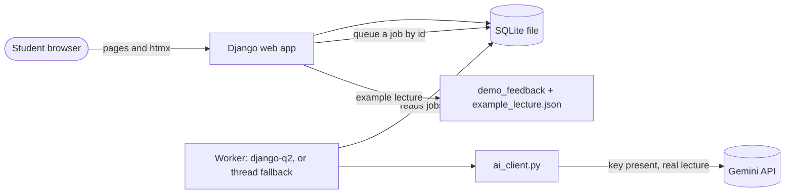
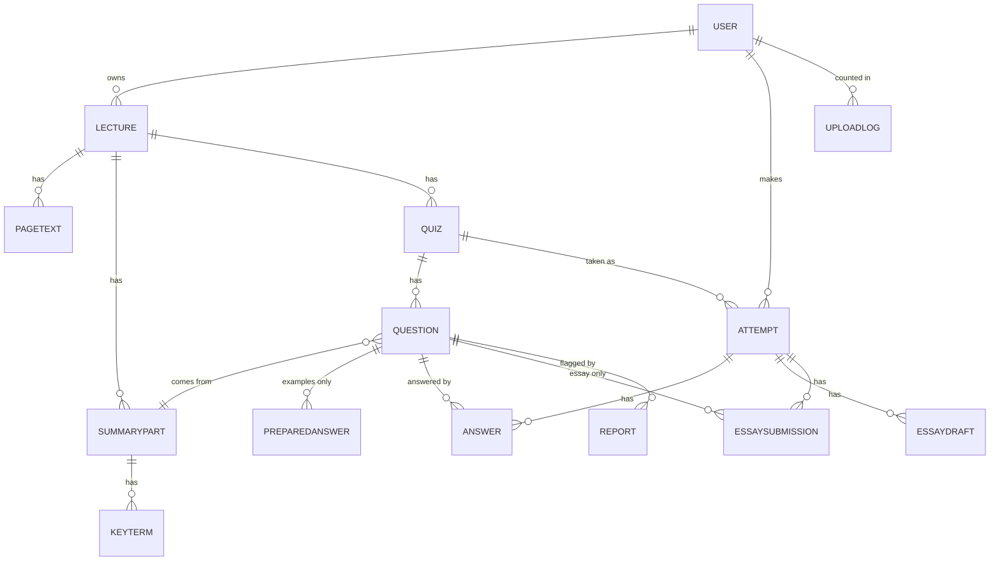

# Architecture Spine — Recall

## Design Paradigm

**Layered monolith.** One Django project. Pages are rendered on the server and made interactive with htmx plus one small hand-written script (no JavaScript framework, no build step). Dependencies point one way only.


## Invariants & Rules

### AD-1 — Django, htmx and SQLite are the whole stack [ADOPTED]

- **Binds:** all
- **Prevents:** a second frontend language, a build step, or a database server that the examiner must install
- **Rule:** Pages are Django templates. Interactivity is htmx plus one hand-written file `static/js/app.js` (no framework, no build step, no inline scripts) for the text-size control, the essay-draft backup and focus helpers. Storage is one SQLite file, `db.sqlite3` in the project root, ignored by git. Accepted trade-off: quiz screens are harder in Django than in a JavaScript framework; htmx covers instant feedback, tabs with saved progress, processing status and essay feedback. Any new tool needs a written reason in the memlog or a new AD.

### AD-2 — One-way dependencies, thin views, named pure modules [ADOPTED]

- **Binds:** all code; the checklist for reviewing AI-written code
- **Prevents:** scoring or prompt text hidden in views, circular imports, logic that cannot be tested without a key, the same rule written twice
- **Rule:**
  1. Views read the request, call one service function, render a template. No scoring, matching or prompt text in views or templates.
  2. Pure modules in `core/`: `scoring.py` (scores, Review List entry points), `matching.py` (Fill-in-the-Gaps rules), `review_list.py`, `validation.py` (AI-output checks), `text_utils.py` (AD-21), `types.py` (frozen dataclasses). They import no models, no request and no network.
  3. Pure modules take and return the dataclasses in `core/types.py` (`AnswerRecord`, `QuestionRecord`, `AttemptResult`, `SourceRef`). Score and Review List each have exactly one entry function; no view or service computes a score itself. The score denominator is the number of questions in the quiz, never the number of `Answer` rows. A skipped or unvisited question counts as wrong (FR-13, FR-15).
  4. `ai_client.py` is the only module that imports the Gemini library. `pdf_text.py` is the only module that imports pdfplumber. Only `jobs.py` imports django-q2.
  5. Jobs call the same service functions as views.
  6. Import direction: views and jobs, then services, then pure modules and the two wrappers. Never the reverse.
  7. A test reads the imports of every module and fails on a broken rule (AD-14).

### AD-3 — Background work: one worker behind one interface [ADOPTED]

- **Binds:** FR-5, FR-8, FR-12, FR-14, FR-16, FR-17, SM-1
- **Prevents:** work tied to the open page; duplicate runs that double the AI cost; a lecture stuck in "Processing…"; lecture text left in queue tables
- **Rule:**
  1. All queueing goes through `jobs.enqueue(name, object_id)`. Jobs receive an integer id and return nothing. No page text, AI output or essay text is ever a job argument or return value.
  2. Engine: django-q2 with the ORM broker and exactly one worker. Settings: `workers: 1`, `timeout: 240`, `retry: 300` (always larger than `timeout`), `max_attempts: 1` (retries are our own explicit status change, below), successful results not saved. Check the setting names against the django-q2 documentation at install.
  3. **Windows fallback (accepted):** if the django-q2 cluster does not run on Windows, use a thread-based worker behind the same `jobs.enqueue` interface, reading the same job table, tested the same way: start a job, close the page, check it finishes, check it does not run twice.
  4. Enqueue happens inside `transaction.on_commit`, so a worker never starts before the row exists.
  5. Status changes only through `set_status(obj, from_states, to_state)`: a conditional `UPDATE … WHERE status IN from_states` that returns whether it changed anything. A caller that gets `False` stops. The job's first action is this call, and it is the real lock against duplicate runs. "Result already stored" is only a second check.
  6. Allowed changes: `processing → ready | failed`, `failed → processing` (retry, at most 3 per lecture); quiz `not_made → making → ready | failed`, `failed → making` (at most 3); essay submission `queued → done | failed`.
  7. Every status row has `status_changed_at`. A row in `processing` or `making` for longer than `STALE_MINUTES` (default 10) is treated as `failed`. `reap_stale()` runs at the start of `run.py` and inside the status view.
  8. Delete is allowed in any state, including a stuck one. A job checks that its row still exists and still has the expected status immediately before its final write, and silently drops its output otherwise.
  9. Essay feedback is a queued job, like every other AI call, and the page polls for it (AD-11).
  10. With one worker, a Summary job can delay quiz and essay jobs. This is accepted in v1.

### AD-4 — All AI calls go through `ai_client.py`, only from jobs [ADOPTED]

- **Binds:** FR-8..FR-17, FR-23, FR-27, FR-28
- **Prevents:** provider names, keys, retries or rate-limit handling spread across the app; slow AI waits inside web requests; a limiter that web app and worker do not share
- **Rule:**
  1. The rest of the app never names the provider. The provider is Google Gemini on the free tier. The model name is a setting, never written in code. `ai_client.py` always passes the key explicitly and never builds a client in demo mode.
  2. No `ai_client` call is made from a web request. Every AI call is a job, including its waiting.
  3. `ai_client.py` owns: structured output with a schema, the retry loop, waiting on rate-limit errors, the usage log (AD-5), and demo/replay mode (AD-10).
  4. The pure validator `validate_*(output, context)` is called inside the retry loop. The caller passes `context` (page count, page text, summary part ids). The retry budget is 2 extra attempts per logical call, shared by schema and grounding failures (FR-27). No other layer retries an AI call.
  5. Bounds, all settings: per-call timeout `AI_CALL_TIMEOUT_S=60`, longest rate-limit wait `RATE_WAIT_MAX_S=90`, total time per job `AI_JOB_BUDGET_S=220`. When a bound is reached the job ends as `failed` with the plain message of FR-5. An answer that says free quota is zero for the model ("limit: 0") is not retried.
  6. Rate-limit state (requests used this minute and this day) is one database row read and updated in a short transaction, so web app and worker see the same budget.
  7. If the evaluation fails, try a larger Gemini model, then switch provider inside this file only.

### AD-5 — One call per task; all lecture and essay text is untrusted [ADOPTED]

- **Binds:** FR-8..FR-17, FR-27, §6.2 cost
- **Prevents:** many-call chunking that raises cost and breaks Source References; injected instructions or markup in slides or essays
- **Rule:**
  1. Calls: one for the Summary, one per quiz type (made on first open), one per essay submission.
  2. Lecture text is sent with page markers. Each marker carries a random token made for that call (for example `<<S7f3a:12>> … <<E7f3a:12>>`). Any `<<` or `>>` in extracted text or essays is neutralised before sending.
  3. Prompts state that marked text is data, never instructions. The model gets no tools and no links.
  4. Every AI-produced string is stored and shown as plain text. Django autoescape only: `|safe`, `mark_safe` and markdown-to-HTML are forbidden for AI fields (a test searches the templates). The validator rejects output that contains `http`, `<`, `>` or `hx-`.
  5. Model output reaches the database only after validation.
  6. `ai_client.py` refuses text over `MAX_PROMPT_CHARS` with a clear message, as a backstop to the 50-page limit.
  7. Essay answers are limited to `ESSAY_MAX_CHARS=3000`.
  8. Essay feedback returns the **indices** of the covered Reference Key Points. The Essay Rating is computed from those indices by one pure function and is never stored; validation rejects out-of-range indices.
  9. The Questions call receives the stored Summary Parts with their ids. The model returns `part_id` for each question, validated against existing parts.
  10. The Summary call returns the slide language (`en` or `nb`), validated. Prompts say: write in the language of the slides.
  11. Each call logs one `AiCallLog` row: model, prompt version, approximate token counts, wait time, task, user id. Never content.

### AD-6 — Prompts are versioned files [ADOPTED]

- **Binds:** FR-10, FR-25, FR-28, FR-30
- **Prevents:** prompt text in code; evaluation reports that cannot say which prompt they tested; fingerprints that break on another operating system
- **Rule:** `prompts/summary.md`, `prompts/questions.md`, `prompts/essay_feedback.md`. Each header holds a version number and a changelog line; the body holds the plain-language instruction (FR-10) and named slots. Only `ai_client.py` loads them. The evaluation records each version and a fingerprint of the file text, and refuses to run if the text changed but the version did not. Fingerprints are computed after turning `\r\n` into `\n`, and `.gitattributes` marks `*.md`, `*.json` and `*.txt` as `text eol=lf`. The last-seen fingerprints are kept in `evaluation/prompt_fingerprints.json`. Each changelog line names the evaluation report it was checked with. Lecture and Quiz rows store `generated_with` (model, prompt version) so a report can be traced to a prompt.

### AD-7 — Login uses Django's built-in system with an email-based user model [ADOPTED]

- **Binds:** FR-1, FR-2, SM-7
- **Prevents:** a user model that has to be replaced after the first migration; two accounts for one email; guessable passwords without limit
- **Rule:** `django.contrib.auth` with a custom user model whose username is the email address. Creating that model and setting `AUTH_USER_MODEL` is **build step 1, before the first migration**. All ownership links point to `settings.AUTH_USER_MODEL`. The email is stored stripped and lower-case, with a unique index on it. Django's default password validators stay on. Login allows 5 failures per 15 minutes per account and address (database-backed cache). The `next` redirect is checked with `url_has_allowed_host_and_scheme`. No email verification and no password reset in v1. The user row holds `notice_ack_at` and `notice_version` (AD-16).

### AD-8 — Ownership and access: one door to every row [ADOPTED]

- **Binds:** FR-2, FR-21, FR-22, SM-7
- **Prevents:** one user reaching another's data through a nested id; "forgot to check" on a single page; existence leaks
- **Rule:**
  1. Views get a lecture only through an owner-scoped manager (`Lecture.objects.for_user(user)`). Children are reached only through the lecture (`lecture.questions.get(pk=…)`), never by a raw id.
  2. A wrong user, a missing id and a write to an example row all return the same 404 page.
  3. All mutating endpoints go through `get_lecture_for_write(user, id)`, which rejects example rows.
  4. A generated test walks `urls.py` and requests every route as user B with user A's ids, and as a logged-out visitor (SM-7).
  5. Logged-out requests go to login and return no lecture data (FR-2). The Example Lecture is the only exception.

### AD-9 — PDF text extraction behind one function [ADOPTED]

- **Binds:** FR-3, FR-4, FR-8
- **Prevents:** a library choice leaking into the app; an AGPL dependency; shifted slide numbers
- **Rule:** `pdf_text.extract_pages(pdf) -> list[str]` returns exactly one string per PDF page, in order. An unreadable or image-only page gives an empty string; pages are never filtered, so index + 1 is always the slide number. The average characters per page (FR-4) is computed over all pages. Library: pdfplumber (MIT). PyMuPDF is excluded because of its AGPL licence. The first build step after setup is the FR-4 test on a real PowerPoint-exported PDF. If the output is messy, try pypdf on the same file and keep whichever has fewer broken words (hyphenated line breaks, run-together words, ligature glyphs) in a sample of 5 slides chosen by the builder. Record the result and the sample in `docs/`.

### AD-10 — Demo Mode uses the same screens and the same tables [ADOPTED]

- **Binds:** FR-2, FR-23, FR-24, SM-9
- **Prevents:** a second set of demo screens that drifts from the real app; demo data leaking between visitors; real AI calls on example data
- **Rule:**
  1. The Example Lecture is loaded from `example_lecture.json` by `manage.py load_example` only. The command is idempotent (a unique `Lecture.example_key`, one IMMEDIATE transaction). `run.py` calls it before starting the processes. Tests build their own small example from a fixture.
  2. Mode is decided per object, never globally. An example lecture never reaches `ai_client`: views send its essays to `demo_feedback(question_id, prepared_answer_id)`. A real call happens only if a key exists and the lecture is not an example.
  3. With no key the app starts and every upload shows "Processing needs an API key. See the README." The "Try the demo" button is always available.
  4. The banner shows whenever the current lecture is an example, and on the login page when no key is set.
  5. Only `Lecture`, `SummaryPart`, `KeyTerm`, `Question` and `PreparedAnswer` may be example rows (`user` empty, `is_example = True`). `Attempt`, `Answer`, `EssaySubmission` and `EssayDraft` have `user` NOT NULL in the database. Example rows cannot be edited or deleted.
  6. Progress on the Example Lecture lives in the Django server-side session (database-backed) under one key, `demo_progress`, using the same dataclasses. Services expose a `ProgressStore` with two implementations (database, session) behind one interface, so views have one code path.
  7. Prepared essay answers are stored in `PreparedAnswer` with their stored feedback. Replay is one lookup keyed by (task, ids) with two data sources: the demo data and the test fixtures.
  8. Content comes from the builder's own or freely licensed slides, never course material. Summary, questions and essay feedback come from a real AI run that the builder reviewed. The data file records the date, model, prompt versions, reviewer and review notes.

### AD-11 — Status by polling; progress saved on the server [ADOPTED]

- **Binds:** FR-5, §6.6, EXPERIENCE (Processing, Interaction Primitives, Essay behaviour)
- **Prevents:** WebSockets or push services; lost answers after a reload; stale drafts overwriting new text
- **Rule:**
  1. One status address shape, `/status/<kind>/<id>/`, and one partial template. htmx polls it every `POLL_SECONDS=3` and stops when the status is Ready or Failed.
  2. Every answer is saved on the server when it is checked or skipped. The page is rebuilt from the database on reload.
  3. The essay draft is saved after `DRAFT_SAVE_MS=2000` without typing. Each save raises a server-side `version` number. The browser backup in `localStorage` is stored as `{userId, attemptId, questionId, version, text}` under a key that includes the user id. It is used only if its `version` is not lower than the server's. It is deleted on submit, on logout, and on page load when the logged-in user differs.
  4. The draft row belongs to (attempt, question) and is deleted in the same transaction that creates a submission.
  5. For the Example Lecture the same requests write to the session store (AD-10).
  6. A failed save shows a plain message and keeps the typed text (AD-19 covers how failures are noticed).

### AD-12 — Configuration, secrets and a clean first start [ADOPTED]

- **Binds:** FR-24, §6.1, SM-9
- **Prevents:** committed keys; a placeholder that switches off Demo Mode; an app that cannot start without a `.env`
- **Rule:**
  1. Settings are read only in `settings.py`, using django-environ, from `.env`. `.env` is in `.gitignore`. `.env.example` is committed with every setting and a comment, and ships `GEMINI_API_KEY=` empty.
  2. A key counts as present only if it is not empty after stripping, is not on a short placeholder list, and has a plausible shape. A test starts the app with a copied `.env.example` and with a hostile environment variable.
  3. `DEBUG` is on only when `RECALL_ENV` is unset or `local`. If `DEBUG` is off and `SECRET_KEY` is missing, the app stops with a clear message. `ALLOWED_HOSTS` defaults to `localhost,127.0.0.1`. WhiteNoise serves static files so the same path works with `DEBUG` off.
  4. The app and the tests start with no `.env`. A missing key means Demo Mode.
  5. Named settings with defaults: `MAX_PROMPT_CHARS`, `ESSAY_MAX_CHARS=3000`, `POLL_SECONDS=3`, `DRAFT_SAVE_MS=2000`, `N_MC=10`, `N_FILL=8`, `N_ESSAY=2`, `REPORT_MAX_CHARS=300`, `STALE_MINUTES=10`, the AI bounds of AD-4, the budgets of AD-23. Prompts and validators read the same values.
  6. A test fails if `.env` is tracked by git or a key-like string is in committed files. It skips with a message when git is missing and then scans the files.
  7. Setup: pip, a virtual environment and `requirements.txt` with exact versions, for Python 3.12 or 3.13 only. `run.py` and the README check the version. The README shows Windows commands first.
  8. `scripts/fresh_clone_check.ps1` builds a new virtual environment, installs the requirements, runs `run.py`, opens `/` and the demo, posts an example answer and tries an upload with no key. The result is recorded in `docs/`.

### AD-13 — Evaluation is a two-step command [ADOPTED]

- **Binds:** FR-25..FR-31, SM-1, SM-5, SM-10, SM-11, SM-C1..SM-C3
- **Prevents:** human checks that float free of the report and the prompt version; a second AI as judge; a run lost halfway
- **Rule:**
  1. `python manage.py evaluate` runs the AI and the automatic checks (structure, slide references, key terms in text, one correct answer, essay ranking over 3 runs, elapsed time per lecture for SM-1). It writes a report to `evaluation/reports/` with a review sheet of checkboxes for faithfulness, completeness, question grounding, answer keys, source-reference spot checks and wording (FR-10), shown next to the slide text. The report also lists Summary length next to coverage (SM-C3), the number of duplicate or unclear questions (SM-C1) and a difficulty note (SM-C2).
  2. `evaluate --finish <report>` refuses if any box is unticked, then prints the final pass or fail for SM-10.
  3. `evaluate --compare <report1> <report2>` shows what changed (FR-30).
  4. Results are cached per (lecture, task, prompt fingerprint, run number), so an interrupted run resumes. Daily limits may make an evaluation take several days.
  5. The Test Set lives in `evaluation/testset/` as plain files with a stored fingerprint (computed as in AD-6). A test fails if frozen files change (FR-26).
  6. The evaluation paces itself to the rate limits and never runs inside `manage.py test`.
  7. The builder is the judge (PRD §5.7). A second AI as judge is rejected.
  8. `manage.py export_reports` writes the user reports of FR-22 to a file for FR-31. There is no admin screen.

### AD-14 — Tests never call the AI and need no `.env` [ADOPTED]

- **Binds:** §5.5, SM-3, SM-4, SM-6, SM-7, SM-8, FR-27
- **Prevents:** tests that cost money, flake, or need secrets; rules that nobody checks
- **Rule:** Tests run with `python manage.py test` (Django's built-in runner). They use `ai_client` replay with stored sample responses, including deliberately broken ones. Each test name or comment states the FR or SM it verifies. Required tests: the import-boundary test (AD-2), the generated URL-by-user test (AD-8), the template search for unsafe rendering (AD-5), the settings and `.env` test (AD-12), the notice test (AD-16), the fingerprint tests (AD-6, AD-13).

### AD-15 — Local only in v1; logs without content [ADOPTED]

- **Binds:** FR-7, FR-24, §6.1
- **Prevents:** private text in logs; a deployment that was never reviewed; a daily limit that resets by accident
- **Rule:**
  1. `python run.py` runs `migrate`, `load_example` and `reap_stale`, then starts the web app (`runserver --noreload`) and the worker together. It works on Windows and stops both on Ctrl+C.
  2. Logs go to the console and to one file per process (`logs/web.log`, `logs/worker.log`) with job events, AI call counts, model and rate-limit waits. Exceptions from AI, parsing or validation code are logged by class name and a code only. Never lecture text, essay answers, passwords or keys.
  3. No backups in v1; the README says the SQLite file is the only copy.
  4. The README has an "if you deploy this" section: `DEBUG` off, a real `SECRET_KEY`, `ALLOWED_HOSTS`, HTTPS, a production server that runs on the host (Waitress on Windows), static files through WhiteNoise, a persistent disk, one worker, a paid AI key, and a privacy review. It states plainly: in v1 the free Gemini key is used only by the builder, as the developer, locally; the examiner uses Demo Mode or their own key; offering Recall to other users in the EEA, Switzerland or the UK requires a paid key under Google's terms (AD-16.7).
  5. The daily upload limit (FR-7) is counted in `UploadLog`, per user, by local date in `LIMIT_TIME_ZONE` (default `Europe/Oslo`). The check and the insert happen in one IMMEDIATE transaction after validation succeeds and before the job is queued. A retry of a failed lecture adds no row but is capped at 3 per lecture. Rejected uploads (FR-3, FR-4) do not count. Deleting a lecture does not reduce the count.

### AD-16 — The upload notice repeats Google's terms exactly [ADOPTED]

- **Binds:** FR-6, FR-11, §6.1, EXPERIENCE (Upload notice)
- **Prevents:** a notice that overstates or understates what Google's terms say; an upload without acknowledgement
- **Rule:**
  1. The notice quotes the terms in Google's own words, no more and no less. The quotes, the source links and the dates are in `gemini-terms-checked-2026-10-17.md`: checked 2026-10-17; the terms page showed "Effective March 23, 2026" and "Last updated 2026-04-28 UTC". The notice text is in EXPERIENCE.md ("Upload notice").
  2. The upload service refuses an upload unless the user's `notice_ack_at` is set and `notice_version` is the current version. A test checks this. A second test checks that the notice contains the stored quotes.
  3. When the stored quotes change, the notice changes and `notice_version` goes up, so every user must read it again.
  4. The terms address the API customer ("you"). They do not say whose location counts when someone else's text goes through that key. The notice repeats the terms and does not decide this.
  5. The AI notice on Summary and Quiz pages (FR-11) is in the shared base template.
  6. During development only the builder's own or freely licensed slides are sent.
  7. **Who uses the free key (builder's decision, 2026-10-17: keep the free tier):** in v1 the free Gemini key is used only by the builder, as the developer, locally. The examiner uses Demo Mode or their own key. Offering Recall to other users in the EEA, Switzerland or the UK requires a paid key under Google's terms; the "Use Restrictions" section says "You may use only Paid Services when making API Clients available to users in the European Economic Area, Switzerland, or the United Kingdom." This rule is repeated in the README's "if you deploy this" section (AD-15), the explainer and the PRD (§6.1). Nobody else receives a free key from the builder, and Recall is not hosted for others on it. Re-read the terms before any release outside this course.

### AD-17 — The complete list of tables [ADOPTED]

- **Binds:** FR-5, FR-8, FR-12..FR-22, FR-27, §6.6
- **Prevents:** two sessions inventing different storage for page text, quiz progress, drafts, uploads or usage
- **Rule:** These are all the tables. `django-q2`'s tables are infrastructure only and hold no content.

| Table | Key columns and constraints |
| --- | --- |
| `User` | email (unique, lower-case), `notice_ack_at`, `notice_version` |
| `Lecture` | user (empty only for examples), `is_example`, `example_key` (unique), title, `language` (`en` or `nb`), status, `status_changed_at`, `retry_count`, `generated_with` |
| `PageText` | lecture, number (1-based), text; unique (lecture, number) |
| `SummaryPart` | lecture, order, heading, text, source refs |
| `KeyTerm` | summary part, term, explanation |
| `Quiz` | lecture, type, status, `status_changed_at`, `retry_count`, `generated_with`; unique (lecture, type) |
| `Question` | quiz, summary part, order, text, options and answer key (JSON), source refs; essay key points with source refs (JSON) |
| `PreparedAnswer` | question, text, stored feedback (examples only) |
| `Attempt` | user NOT NULL, quiz, status (`in_progress` or `finished`), `current_index`, `started_at`, `finished_at`; at most one `in_progress` per (user, quiz), enforced by a partial unique index |
| `Answer` | attempt, question, value, `is_correct`, `is_skipped`; unique (attempt, question); written once |
| `EssayDraft` | attempt, question, text, `version`; unique (attempt, question) |
| `EssaySubmission` | attempt, question, `seq` (1 to 3), text, status, `covered` (JSON of indices), feedback (JSON); unique (attempt, question, `seq`) |
| `Report` | question (set to empty if the question is deleted), user (empty allowed for examples), reason, snapshot of question text, key, source refs, prompt version and model, timestamp |
| `UploadLog` | user, `created_at` (UTC), `local_day` |
| `AiCallLog` | user, task, model, prompt version, token counts, wait time, timestamp |
| `RateLimitState` | one row: minute and day counters |

JSON fields are allowed only for: multiple-choice options and key, essay key points, source refs, `covered`, and essay feedback. Source refs use the shared `SourceRef` field (AD-21).

### AD-18 — Generated content, essay submissions and answers [ADOPTED]

- **Binds:** FR-5, FR-8, FR-12..FR-19, FR-21, FR-27
- **Prevents:** half-written summaries; orphaned answers; a fourth essay submission; a changed answer
- **Rule:**
  1. A Summary is written once, in one short transaction, and never replaced after the lecture is `ready`. Only a `failed` run (no rows exist) may be retried. A Quiz works the same way. Regenerating a ready lecture is not a v1 feature; the evaluation uses its own in-memory path and writes nothing to user tables.
  2. Foreign keys from `Answer`, `Attempt` and `Report` use PROTECT toward content, so a stray delete fails loudly. Deleting a lecture deletes everything in one transaction (FR-21), except that a `Report` keeps its snapshot.
  3. `Answer` is written once; a second check of the same question is refused by the server. Templates receive questions without the answer key until the answer exists.
  4. `seq` of an essay submission is assigned inside one IMMEDIATE transaction. A fourth submission is refused. "Last" means the highest `seq` with status `done`. A failed submission does not count toward the 3 but does count toward the AI budget (AD-23).
  5. "Start again" finishes the open attempt and creates a new one, with a fresh 3 submissions.
  6. In code, "attempt" always means `Attempt`. The student-visible "Attempt 2 of 3" comes from `EssaySubmission.seq`. A comment in `models.py` says so.
  7. The original PDF is not kept. Only per-page text is stored. Deleting a lecture removes everything. Re-processing an old lecture needs a new upload. A failed run after extraction can be retried from the stored page text.

### AD-19 — Web safety for pages and htmx [ADOPTED]

- **Binds:** FR-1, FR-2, §6.1, EXPERIENCE
- **Prevents:** silent save failures; content visible after logout; script injection from a PDF; actions started by a link
- **Rule:**
  1. Django CSRF protection stays on. The base template sends the token with every htmx request (`hx-headers` on `<body>`). `htmx:responseError` and `htmx:sendError` show the plain message and never discard what was typed.
  2. Every state-changing action (quiz generation, retry, delete, logout, saves) is POST only. GET requests are safe and repeatable. `CSRF_COOKIE_SAMESITE` and `SESSION_COOKIE_SAMESITE` are `Lax`.
  3. `htmx.config.historyCacheSize = 0`. Every logged-in response sends `Cache-Control: no-store`. Logout clears all `localStorage` keys starting with `recall:` and `htmx-history-cache`.
  4. A content security policy: `default-src 'self'; script-src 'self'; object-src 'none'; base-uri 'none'`. htmx runs with `allowEval=false` and `selfRequestsOnly=true`. htmx is a file in the repository, never loaded from a network.
  5. AI text is shown as plain text only (AD-5).

### AD-20 — The upload pipeline [ADOPTED]

- **Binds:** FR-3, FR-4, FR-5, FR-7
- **Prevents:** rejections that show up late as a failed lecture; memory or time blow-ups from a hostile PDF; a stored PDF; lecture text in queue tables
- **Rule:** In order: (1) count the bytes while streaming and stop at 10 MB + 1 (`DATA_UPLOAD_MAX_MEMORY_SIZE` set, `TemporaryFileUploadHandler`); (2) check the `%PDF-` header; (3) run `extract_pages` in a subprocess with a 20 second limit and a memory cap; (4) check the page count (50) and the characters per page (FR-4); an encrypted or corrupt PDF gets the "no text we can read" message; (5) check the daily limit and the AI budget (AD-15, AD-23); (6) in one short transaction create the `Lecture` (status `processing`) and the `PageText` rows and write the `UploadLog` row; (7) queue the job with the lecture id. The temporary file is deleted in a `finally`. A rejection at steps 1 to 5 creates no `Lecture` and makes no AI call. No model has a file field. The Processing page shows "Reading your PDF" as done and "Writing the summary" as in progress, and no other steps, because those are the only steps the app knows.

### AD-21 — Shared text and shapes [ADOPTED]

- **Binds:** FR-4, FR-9, FR-15, FR-27, chips in EXPERIENCE
- **Prevents:** key terms that fail on ligatures; two different ways to store or print slide numbers
- **Rule:**
  1. `core/text_utils.py` has one `normalize_text()` (Unicode NFKC, case folding, collapsed whitespace, soft hyphens removed, hyphenated line breaks re-joined). It is applied to the output of `extract_pages`, in grounding checks and in answer matching. Edit distance (FR-15) is computed on normalised text.
  2. `SourceRef` is the sorted, de-duplicated list of every slide number, never range endpoints. One field type stores and checks it (numbers within the page count). One function, `format_slides(refs)`, writes "Slides 12 to 15" and joins only runs of three or more consecutive numbers ("Slides 3, 7 and 12" otherwise).
  3. The dataclasses of AD-2 are the only shapes pure modules accept.

### AD-22 — Page structure for htmx [ADOPTED]

- **Binds:** EXPERIENCE (Information Architecture, Interaction Primitives, Accessibility Floor)
- **Prevents:** each unit choosing its own partial rendering and focus handling
- **Rule:** Every address renders a full page; when the request carries `HX-Request` it returns only the partial. Tabs use `hx-push-url` and update the page `<title>`. One shared template macro per component class (feedback card, status row, essay feedback) sets `hx-swap`, the focus target and the live region. App code in `static/js/app.js` is limited to the text-size control, the essay backup and focus helpers.

### AD-23 — AI cost caps [ADOPTED]

- **Binds:** FR-7, §6.2
- **Prevents:** one account using up the shared free-tier key; retries and restarts that bypass the upload limit
- **Rule:** Before a job is queued, the service checks a per-user per-day AI call budget (`AI_CALLS_PER_USER_PER_DAY`) and a global per-day ceiling (`AI_CALLS_GLOBAL_PER_DAY`) against `AiCallLog`. Retries are capped per object (AD-3, AD-15). Both budgets are settings.

### AD-24 — SQLite settings and transactions [ADOPTED]

- **Binds:** AD-3, AD-17, AD-18
- **Prevents:** "database is locked" errors that the student sees as failed saves
- **Rule:** On connection: `PRAGMA journal_mode=WAL; synchronous=NORMAL; foreign_keys=ON`. Django `OPTIONS` use `timeout: 20` and `transaction_mode: 'IMMEDIATE'`. No AI call and no PDF read inside `atomic()`. A transaction holds only the final write and lasts under one second.

## Consistency Conventions

| Concern | Convention |
| --- | --- |
| Naming | Python modules and functions in `snake_case`; classes in `PascalCase`; FR and SM numbers in test names and comments; "attempt" means `Attempt` (AD-18) |
| Data & formats | Slide numbers are integers starting at 1 and equal the PDF page number; `SourceRef` as in AD-21; times stored in UTC; the upload day uses `LIMIT_TIME_ZONE` |
| State & cross-cutting | Status changes only through `set_status()`; student-facing errors use the plain messages in `EXPERIENCE.md`; settings only in `settings.py`; no secrets or content in logs |
| Upload handling | AD-20 |
| Rendering | AD-5 and AD-19: plain text for AI output, no `|safe` |
| Notices | The AI notice (FR-11) is in the shared base template; the upload notice is AD-16 |

## Stack

Verified on 2026-10-17 from PyPI, GitHub and official documentation (see `reviews/review-verify-tech.md`).

| Name | Version |
| --- | --- |
| Python | 3.12 or 3.13 only; 3.13 recommended |
| Django | 5.2 LTS, 5.2.18 (extended support to April 2028) |
| django-q2 | 1.11.1 (lists Django 5.2); Windows behaviour tested at install, fallback in AD-3 |
| htmx | 2.0.10, one file kept in the repository (htmx 4 is not used) |
| pdfplumber | 0.11.10 (MIT) |
| google-genai (Gemini SDK) | 2.31.0 |
| django-environ | 0.14.0 |
| WhiteNoise | pin at install |
| SQLite | the version in Python's standard library; WAL mode (AD-24) |

The Gemini model name is a setting. Google's current advice for new projects is 3.5 Flash-Lite or 3.8 Flash; 2.0 models were shut down on 2026-06-01 and `gemini-3.1-flash-lite` shuts down on 2027-05-07. Pick the model from Google's pages when the AI client is built, and record the date.

## Structural Seed





```text
recall/                  # repository root
  run.py                 # migrate, load_example, reap_stale, then web app + worker (Windows-safe)
  manage.py
  requirements.txt       # exact versions
  .env.example           # every setting, no real keys
  .gitignore  .gitattributes
  db.sqlite3             # ignored by git
  logs/                  # web.log, worker.log (ignored by git)
  prompts/               # summary.md, questions.md, essay_feedback.md
  example_lecture.json   # reviewed AI output, with provenance
  samples/test.pdf       # small, freely licensed test PDF
  static/js/app.js       # text size, essay backup, focus helpers
  static/htmx.min.js     # htmx 2.0.10, kept in the repository
  templates/
  scripts/fresh_clone_check.ps1
  evaluation/
    testset/             # frozen lectures, key points, essay answers
    reports/             # evaluation reports
    prompt_fingerprints.json
  accounts/              # custom user model, login views
  lectures/              # models, views, templates, services, management/commands (evaluate, load_example, export_reports)
  core/                  # ai_client, pdf_text, jobs, scoring, matching, review_list, validation, text_utils, types
  docs/                  # extraction test result, accessibility results, fresh-clone result
```

## Capability → Architecture Map

| Capability / Area | Lives in | Governed by |
| --- | --- | --- |
| Accounts, privacy (FR-1, FR-2) | `accounts`, owner-scoped managers | AD-7, AD-8, AD-19 |
| Upload, validation, limits (FR-3, FR-4, FR-6, FR-7) | `lectures` services, `pdf_text` | AD-9, AD-15, AD-16, AD-20 |
| Processing status (FR-5) | `jobs`, status view | AD-3, AD-11 |
| Summary, key terms (FR-8..FR-11) | services, `ai_client`, prompts | AD-4, AD-5, AD-6, AD-16 |
| Quizzes, essay feedback (FR-12..FR-17) | services, `scoring`, `matching`, `ai_client` | AD-2, AD-5, AD-17, AD-18 |
| Results, Review List (FR-18, FR-19) | `scoring`, `review_list` | AD-2, AD-18 |
| Saved lectures, delete, report (FR-20..FR-22) | `lectures` | AD-8, AD-17, AD-18 |
| Demo Mode, run locally (FR-23, FR-24) | `ai_client` replay, `example_lecture.json`, `run.py` | AD-10, AD-12, AD-15 |
| Quality checks (FR-25..FR-31, SM-1, SM-C1..SM-C3) | `evaluation/`, `manage.py evaluate` | AD-6, AD-13, AD-14 |
| Pages, tabs, focus (EXPERIENCE) | templates, `static/js/app.js` | AD-1, AD-11, AD-22 |

## Deferred

| Item | Why it can wait |
| --- | --- |
| Exact Gemini model and its limits | Names and free-tier limits change; decide when the AI client is built, from Google's current pages, and record the date |
| How structured output is called in google-genai | Docs show a newer style; spike both styles before building the AI client |
| django-q2 job test on Windows | Run at install; the thread-based fallback is accepted (AD-3) |
| Final extraction library (pdfplumber or pypdf) | Decided by the FR-4 test on a real PowerPoint export (AD-9) |
| Test Set contents and deadline | PRD open questions 2 and 3 |
| Definition of "unsupported statement" for faithfulness | PRD open question 6; needed before the first evaluation |
| Accessibility test pass and Lighthouse results | Implementation step; results go in `docs/` |
| Offering Recall to other users | Needs a paid key in the EEA, Switzerland and the UK (AD-16.7); out of scope for v1, re-read the terms first |
| Deployment, backups, email verification, password reset | Out of scope for v1 (PRD §8.2) |
