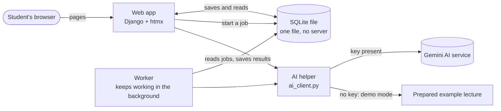

# How Recall is built (one page)

Recall turns a lecture PDF into a plain-language summary and three kinds of quiz questions. This page explains the building plan in simple words. The full rules are in `architecture-recall.md`.

## The picture

## What each part does

- **Web app (Django + htmx).** Shows the pages, handles login, and checks every upload. It is mostly Python and HTML, so it is easy to read. htmx lets a page update one part (a quiz result, a status line) without a full reload.
- **SQLite file.** The database is one file in the project. Nobody needs to install a database server.
- **Worker.** When you upload a PDF, the web app saves a job and returns at once. The worker does the slow AI work. This is why processing continues if you close the page. The page asks every few seconds "is it done?" and stops asking when it is.
- **AI helper.** Every AI call goes through one file. It checks the AI's answer, retries if the answer is unusable, and waits if the free service says "too many requests". With no key, it uses the prepared example instead.
- **Prompts.** The instructions we send to the AI are text files in the `prompts/` folder, each with a version number.

## Why it runs for the examiner without keys

Without an API key the app starts in **Demo Mode**. It shows an example lecture whose summary, questions and essay feedback came from a real AI run that I reviewed. One command (`python run.py`) starts the web app and the worker together, also on Windows. A test PDF and a `.env.example` file are in the repository. Real keys stay in `.env`, which git ignores.

## Rules that keep the code tidy

1. Pages only receive a request and show a result. They contain no scoring or prompt text.
2. Scoring and answer checking are plain Python functions that never touch the database or the internet, so they are easy to test.
3. Only one file talks to the AI, and only one file reads PDFs.
4. A student can only see their own lectures.

## How quality is checked

- **Tests** (`python manage.py test`) check scoring, answer matching, limits and access. They never call the AI and need no key.
- **Evaluation** (`python manage.py evaluate`) sends a fixed set of test lectures to the real AI. The program checks structure, slide numbers and essay ranking. Then I check the rest myself with a review sheet. The report records which prompt versions were used.

## Choices and their cost

| Choice | Why | What we accept |
| --- | --- | --- |
| One web app, no separate JavaScript framework | I only know Python, so I can read and review all the code | Interactive quiz screens take more care |
| SQLite | Nothing to install | One user at a time on the worker, no backups in v1 |
| Gemini free tier | I cannot pay for API use now | Google may use submitted text to improve its products, and limits can change. The upload notice says this, and only my own or freely licensed slides are used in development |
| Local only in v1 | Simple and safe | Not a public website. The README lists what to change before deploying |
